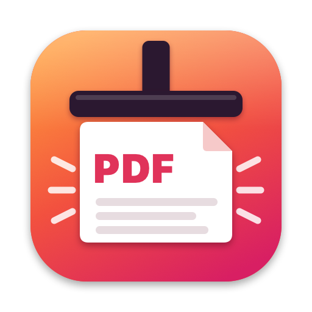
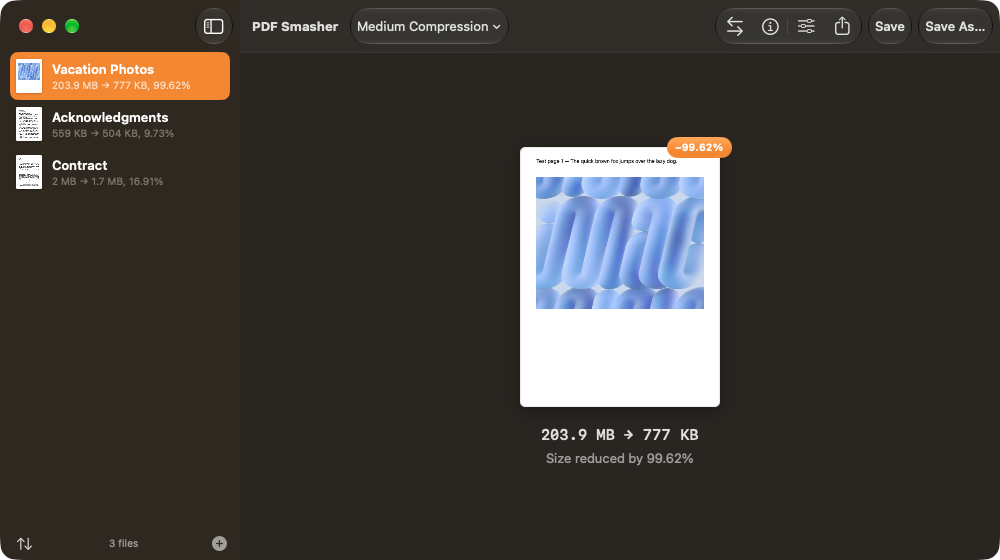
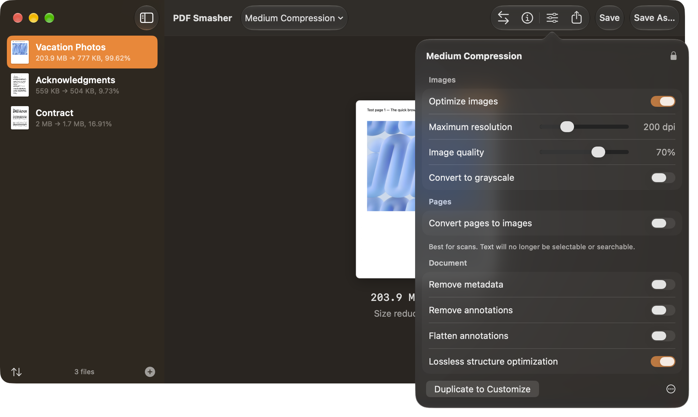

<div align="center">



# PDF Smasher

### Make your PDFs tiny. Free, private, and beautifully simple.

A native macOS app that shrinks PDF files with a single drag and drop.<br>
No subscriptions. No paywalls. No uploads. **Your files never leave your Mac.**

<br>

<a href="https://github.com/alansmathew/PDFSmasher/releases/latest">
  
</a>

<br><br>

[](https://github.com/alansmathew/PDFSmasher/releases/latest)
[](https://github.com/alansmathew/PDFSmasher/releases)


[](LICENSE)


<br>



</div>

<br>

## ✨ Why PDF Smasher?

Email attachment limits, upload forms that reject big files, a full iCloud: oversized PDFs get in the way all the time. PDF Smasher fixes that in seconds.

<table>
<tr>
<td width="33%" valign="top">

### 🪶 Drastically smaller
Image-heavy PDFs often shrink by **90% or more**. In our tests a 204 MB photo document came down to **777 KB** and still looked great on screen.

</td>
<td width="33%" valign="top">

### 🔒 100% private
Everything runs **on your Mac**. No cloud, no account, no tracking, no network access at all. Safe for contracts, medical records and tax returns.

</td>
<td width="33%" valign="top">

### 🆓 Free forever
No trial, no watermark, no "upgrade to save". Every feature is unlocked, and the source code is open for anyone to inspect.

</td>
</tr>
<tr>
<td width="33%" valign="top">

### ⚡ Drag, drop, done
Drop files **or whole folders** onto the window. Compression starts immediately and you see the result before you save anything.

</td>
<td width="33%" valign="top">

### 📝 Even text-only PDFs shrink
Built-in lossless optimization repacks fonts, text and file structure. Text-only documents typically get **10 to 20% smaller** with zero quality loss.

</td>
<td width="33%" valign="top">

### 🍎 Truly native
Built with SwiftUI for a fast, modern Mac experience. Supports dark mode and keyboard shortcuts, and runs natively on Apple silicon and Intel.

</td>
</tr>
</table>

<br>

## 🎛️ Choose how hard to smash

Pick a profile from the toolbar. Every file is re-compressed instantly, so you can try several and keep the one you like.

| Profile | Best for | Images |
| --- | --- | --- |
| **Light** | Printing, archiving at high quality | up to 300 dpi · 85% quality |
| **Medium** | Everyday sharing (default) | up to 200 dpi · 70% quality |
| **Strong** | Email attachments | up to 144 dpi · 55% quality |
| **Extreme** | Upload limits, smallest readable files | up to 96 dpi · 40% quality |
| **Flatten to Images** | Scanned documents | every page becomes a single optimized image |

Need something specific? **Create your own profile** with exact resolution, quality, grayscale and cleanup options, then export it as a `.pdfsmash` file to share with your team.

<div align="center">

</div>

<br>

## 🧰 Everything you get

- 📂 **Batch compression.** Drop hundreds of PDFs or entire folders at once.
- 👀 **Live before/after preview.** See the new size and percentage saved, and toggle **Compare** to view the original.
- 💾 **Flexible saving.** *Save* replaces the original (with **Restore** if you change your mind), *Save As…* creates a copy, and *Save All to Folder…* exports a whole batch.
- 📤 **Share instantly** via Mail, Messages, AirDrop and other share options.
- 🎨 **Grayscale conversion** for even smaller black-and-white documents.
- 🧹 **Clean up documents**: remove metadata, remove comments and highlights, or flatten annotations into the page.
- 🏷️ **Edit document info** such as title, author, subject and keywords.
- 📄 **Extract text** from any PDF to a plain `.txt` file.
- 🛡️ **Never makes things worse.** If a file can't get smaller, your original stays untouched.
- ⌨️ **Command-line tool** for automation and scripts (see below).

<br>

## 📥 Download & install

1. Download **`PDF-Smasher-x.y.z.dmg`** from the [**latest release**](https://github.com/alansmathew/PDFSmasher/releases/latest).
2. Open the DMG and drag **PDF Smasher** into your **Applications** folder.
3. Launch it and drop in a PDF. 🎉

> [!NOTE]
> **"PDF Smasher can't be opened because Apple cannot verify it"?**
> This appears for apps distributed outside the Mac App Store without a paid Apple signature. To open it anyway:
> right-click the app → **Open** → **Open**. On recent macOS versions, go to **System Settings ▸ Privacy & Security** and click **Open Anyway**. You only need to do this once.

**Requirements:** macOS 14 Sonoma or later · Apple silicon or Intel Mac

<br>

## 💻 Command line

PDF Smasher includes `pdfsmash`, a command-line tool for scripts, Shortcuts and automation:

```bash
# Optional: make it available everywhere
sudo ln -s "/Applications/PDF Smasher.app/Contents/Helpers/pdfsmash" /usr/local/bin/pdfsmash

pdfsmash report.pdf                        # → report-smashed.pdf
pdfsmash -p extreme --gray invoices/*.pdf  # maximum compression, grayscale
pdfsmash --dpi 120 -q 50 -o out/ scans/*.pdf
pdfsmash --help                            # all options
```

<br>

## ❓ FAQ

<details>
<summary><b>Is it really free? What's the catch?</b></summary>
<br>
There is no catch. PDF Smasher is open-source software under the MIT license: no ads, no tracking, no in-app purchases. If you find it useful, a ⭐ on GitHub is much appreciated.
</details>

<details>
<summary><b>Will compression ruin the quality of my document?</b></summary>
<br>
Text and vector graphics stay perfectly sharp. Only embedded images are resampled, and you control how much. Use <b>Light</b> or <b>Medium</b> for documents you'll print, and <b>Strong</b> or <b>Extreme</b> for on-screen reading. The <i>Compare</i> button lets you check the result before saving.
</details>

<details>
<summary><b>Does it upload my files anywhere?</b></summary>
<br>
No. PDF Smasher never connects to the internet. Everything happens locally using Apple's PDF engine and the bundled open-source <a href="https://github.com/qpdf/qpdf">qpdf</a> tool.
</details>

<details>
<summary><b>Why didn't my PDF get smaller?</b></summary>
<br>
Some PDFs are already well optimized. Try a stronger profile; for scanned documents, <b>Flatten to Images</b> usually works best. PDF Smasher never saves a file that is larger than the original.
</details>

<details>
<summary><b>Can it open password-protected PDFs?</b></summary>
<br>
Not yet. Files that need a password to open are marked as protected and left untouched.
</details>

<br>

## 🛠️ Build from source

```bash
brew install cmake                       # needed once, to build qpdf
git clone https://github.com/alansmathew/PDFSmasher.git
cd PDFSmasher
Scripts/build-app.sh                     # → dist/PDF Smasher.app + dist/PDF-Smasher-1.0.0.dmg
```

To work on the code, open the folder in Xcode (`xed .`) and run the **PDFSmasher** scheme. In *Edit Scheme ▸ Run ▸ Options*, set the working directory to the project folder so the bundled qpdf is found.

<details>
<summary><b>Signing & notarizing a release</b></summary>
<br>

```bash
xcrun notarytool store-credentials pdfsmasher --apple-id you@example.com --team-id TEAMID
SIGN_IDENTITY="Developer ID Application: Your Name (TEAMID)" NOTARY_PROFILE=pdfsmasher \
VERSION=1.0.0 Scripts/build-app.sh
```
</details>

<details>
<summary><b>Project layout</b></summary>
<br>

```
Sources/SmasherCore/   compression engine, shared by the app and the CLI
Sources/PDFSmasher/    SwiftUI macOS app
Sources/pdfsmash/      command-line tool
Scripts/               build, qpdf and asset-generation scripts
Resources/             Info.plist, icons, image assets, third-party licenses
```

Every icon and illustration is drawn in code by `Scripts/generate-assets.swift`, so the artwork is easy to tweak and fully open source too.
</details>

<br>

## 🤝 Contributing

Bug reports, feature ideas and pull requests are very welcome.

- 🐛 Found a bug? [Open an issue](https://github.com/alansmathew/PDFSmasher/issues/new) and, if you can, attach a sample PDF.
- 💡 Have an idea? Start a discussion or open an issue.
- ⭐ Like the app? **Star the repo** to help others discover it!

<br>

## 📜 License

PDF Smasher is released under the [MIT License](LICENSE).

It bundles [qpdf](https://github.com/qpdf/qpdf) (Apache-2.0) and [libjpeg-turbo](https://github.com/libjpeg-turbo/libjpeg-turbo) (IJG / BSD-3-Clause). Their licenses are included in [`Resources/ThirdParty`](Resources/ThirdParty).

PDF Smasher is an independent project and is not affiliated with any other PDF software vendor.

<br>

<div align="center">


**Made with ❤️ for the Mac.**

<a href="https://github.com/alansmathew/PDFSmasher/releases/latest"><b>Download PDF Smasher →</b></a>

</div>
